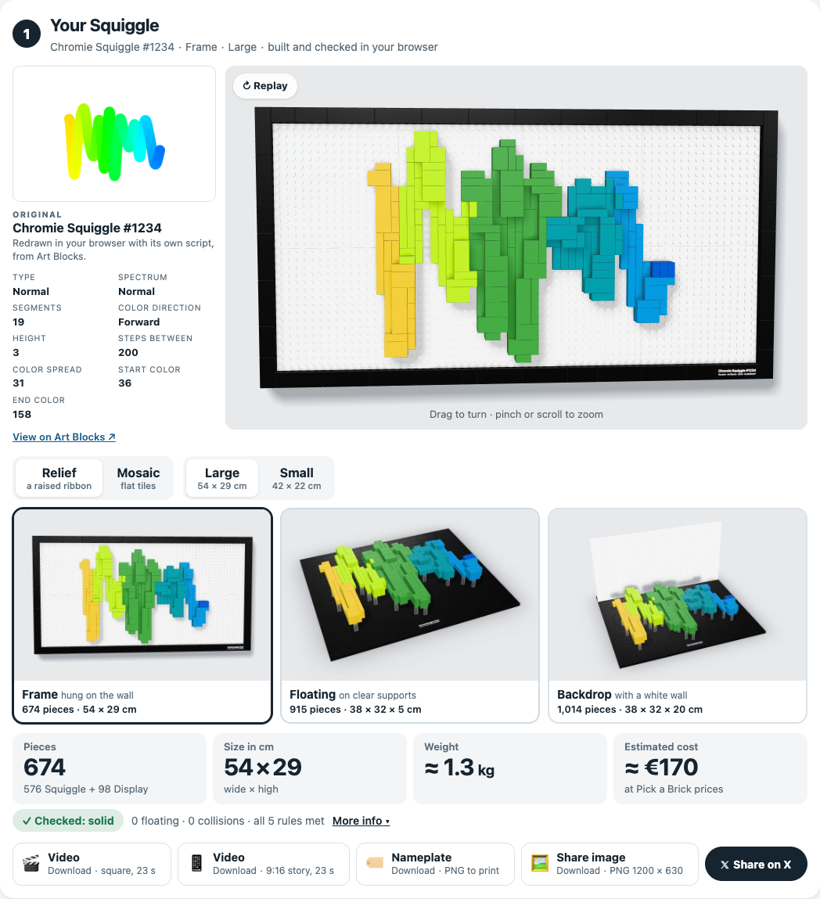
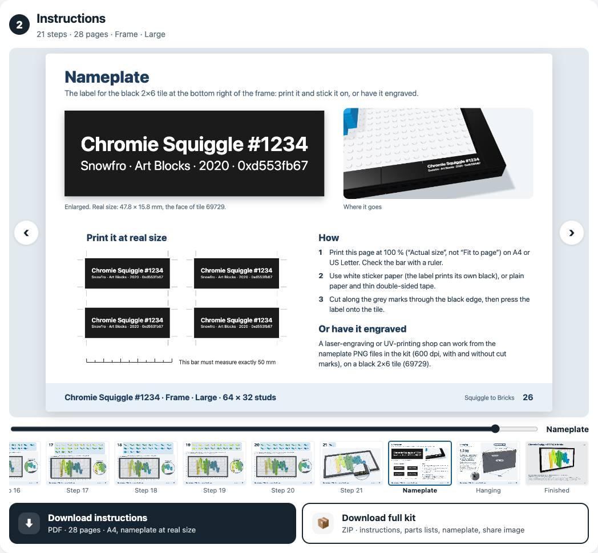
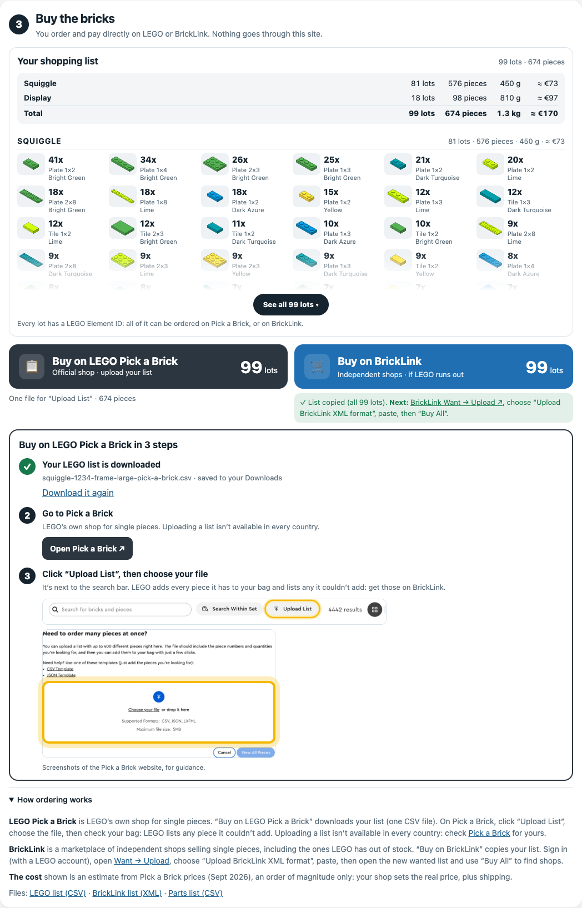

# Squiggle to Bricks

Build your Chromie Squiggle with real bricks. Free, unofficial, personal use.

<p align="center">
  <a href="https://hs7j4yk4sz-boop.github.io/squiggle-to-bricks/"></a>
</p>

<h3 align="center">👉 <a href="https://hs7j4yk4sz-boop.github.io/squiggle-to-bricks/">Open Squiggle to Bricks</a> 👈</h3>
<p align="center">Free · runs in your browser · nothing to install, nothing uploaded</p>

Sister project of [Punk to Bricks](https://github.com/hs7j4yk4sz-boop/punk-to-bricks), which turns a CryptoPunk into a brick bust.

## How to use

1. **Type your Squiggle's number** (0 to 9999) and press Build, or click one of the examples. No number? Upload a picture of your Squiggle instead.
2. **① Your Squiggle**: the original, with its Art Blocks features, next to the brick model building itself in 3D. Turn it with your finger or mouse.
   - Pick the **Relief** (a raised ribbon of bricks) in one of three displays: **Frame** (hung on the wall, the default), **Floating** (on clear supports above a black base) or **Backdrop** (in front of a white brick wall), each shown with its piece count and size. Large or Small.
   - Or the **Mosaic**: flat tiles on black plates, 96 × 48 or 64 × 32 studs.
   - The key figures are big: pieces (Squiggle and Display), size in cm, weight and an estimated cost. "More info" shows every check in plain words and where the Squiggle came from.
   - Download a video of the build (square or 9:16), the nameplate to print, a picture to share, or share on X.
3. **② Instructions**: flip through the booklet right on the page (cover, parts, one page per step, the nameplate, how to hang the Frame), then download it as an A4 PDF or as a full kit (ZIP: PDF, parts lists, order files, nameplate, share picture, README).
4. **③ Buy the bricks**: your shopping list, split into Squiggle and Display with their subtotals, then **Buy on LEGO Pick a Brick** (a Pick a Brick upload file, with a 3-step guide) or **Buy on BrickLink** (a wanted list copied for you to paste). Every lot has a LEGO Element ID.

<p align="center">
  
  
  
</p>

## What's inside

- **100% static.** Everything runs in the visitor's browser: Web Workers build the models, three.js draws them. No server, no AI, no API key, no tracking.
- **The real Squiggle.** The token's hash and features come from Art Blocks' public API, and the Squiggle is redrawn with its own generator script in a sandboxed frame, recording every circle it draws: that is the line the bricks follow. If the script can't run, a faithful TypeScript copy of it redraws the same circles from the hash; if Art Blocks can't be reached, the Squiggle is traced from its published picture, or from a picture the visitor uploads.
- **Four models, one ribbon.** The Relief ribbon is 3 studs wide (4 for Fuzzy, 7 for Bold, 5 for Pipe with its black edges), in 11 spectrum colours. Where the line crosses itself, the later pass steps up a slab, like the drawing. Frame, Floating and Backdrop use the same ribbon. The Mosaic draws the stroke at its true width in tiles.
- **Honest checks.** Every model is checked on its final piece list: studs connected, 0 floating pieces, 0 collisions, every ribbon piece held by at least two studs (Frame), centre of mass over the base (Floating, Backdrop), plus named rules (margins, seams bridged, support spacing, hanging points…). A failed check is shown, never hidden.
- **Order the bricks.** A Pick a Brick upload file in LEGO's own CSV format (400 references and 999 units per line at most, split when needed) and a BrickLink wanted list (Want → Upload → "Upload BrickLink XML format"). Element IDs come from [Rebrickable](https://rebrickable.com)'s free exports, built into `src/data/elements.json` by `scripts/build-elements.ts` (no live calls). Nothing is sold here: you order and pay on LEGO or BrickLink.
- **Exports.** A4 PDF booklet (the nameplate prints at real size, 47.8 × 15.8 mm, with cut marks), parts list CSV, order files, nameplate PNGs at 600 dpi, a 1200 × 630 share picture, and 23-second videos of the build with brick clicks made in Web Audio (MP4 where the browser can, else WebM).

## How it works

1. **Get the Squiggle** (`src/squiggle/load.ts`): `source.ts` fetches the token and redraws it with its own script, `port.ts` is the TypeScript copy of that script, `fromImage.ts` traces a picture back into a curve (background from the corners, stroke from the distance transform, knots fitted to the script's hue ramp).
2. **Read the line** (`curve.ts`, `spectrum.ts`): the centre line in drawing order, the variant (Normal, Bold, Ribbed, Slinky, Pipe, Fuzzy), and a colour per point that moves one spectrum step at a time.
3. **Build** (`ribbon.ts`, `display.ts`, `mosaic.ts`, with `src/core/tile.ts`): stud cells along the line, slabs of three plates stacked where the line comes back, each layer filled with real plates and tiles, joints staggered, no single-stud pieces. Then the display around it: the black Technic frame with its hanging bricks, the base with clear supports, the brick wall with hidden braces, or the Mosaic's base plates and tiles.
4. **Check** (`src/core/check.ts` and each builder's rules) the final piece list.
5. **Show and export**: `stage.ts` and `timeline.ts` (3D view and build animation), `booklet.ts` and `stepRender.ts` (instructions), `exports.ts` (lists, nameplate, share picture, kit), `video.ts`.

## Develop

```bash
npm install
npm run dev        # http://localhost:5173
npm test           # unit tests: builders on 39 recorded Squiggles, the port, the image reader, exports, booklet
npm run verify     # independent checker: every model of every recorded Squiggle
npm run build      # static site in dist/
```

The recorded Squiggles in `test/fixtures/squiggles` (token data and every circle the original script draws) let the builders run in Node without Art Blocks; `scripts/capture-squiggles.cjs` records more. Lab pages for development are in `dev/` (not part of the site): the stage (`dev/stage.html`), the input chain (`dev/load-lab.html`), the booklet and the exports. With the dev server running (`npx vite --port 5180`), `node scripts/ui-flow.cjs` walks the whole visitor journey on desktop and mobile in Chrome, checks every download and writes screenshots to `out/flow/`; `node scripts/site-images.cjs` renders `public/og.png` and `public/hero.jpg`.

## Notes

Unofficial fan project · Not affiliated with, sponsored or endorsed by Art Blocks, the LEGO Group or BrickLink. LEGO® is a trademark of the LEGO Group. Parts data: Rebrickable. Models are computer-checked, not physically built. Personal use only, no sale. No purchases, payments or personal data go through this site.

Chromie Squiggle by Snowfro / Art Blocks. Made by John Karp. Inspired by [@victormustar](https://x.com/victormustar)'s Microduck.

## License

[MIT](LICENSE). See also the [disclaimer](DISCLAIMER.md). The license covers the code only, not the Chromie Squiggle artworks or any trademark.
