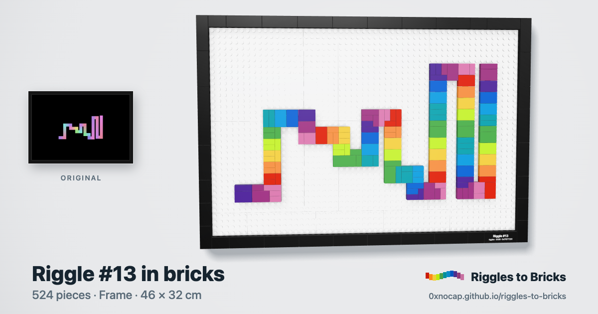

# Riggles to Bricks

Build your riggle with real bricks. Free, unofficial, personal use.

<p align="center">
  <a href="https://0xnocap.github.io/riggles-to-bricks/"></a>
</p>

<h3 align="center"><a href="https://0xnocap.github.io/riggles-to-bricks/">Open Riggles to Bricks</a></h3>
<p align="center">Free · runs in your browser · nothing to install, nothing uploaded</p>

A fork of [Squiggle to Bricks](https://github.com/hs7j4yk4sz-boop/squiggle-to-bricks) by John Karp, ported to
the [riggles](https://riggles.xyz) collection.

## How to use

1. **Type your riggle's number** (1 to 2222) and press Build, or click one of the examples.
2. **① Your riggle**: the riggle, with its traits, next to the brick model building itself in 3D. Turn it with your finger or mouse.
   - Pick the **Relief** (a raised ribbon of bricks) in one of three displays: **Frame** (hung on the wall, the default), **Floating** (on clear supports above a black base) or **Backdrop** (in front of a white brick wall), each shown with its piece count and size. Large or Small.
   - Or the **Mosaic**: flat tiles on black plates, 72 × 48 or 48 × 32 studs.
   - The key figures are big: pieces (riggle and display), size in cm, weight and an estimated cost. "More info" shows every check in plain words.
   - Download a video of the build (square or 9:16), the nameplate to print, a picture to share, or share on X.
3. **② Instructions**: flip through the booklet on the page (cover, parts, one page per step, the nameplate, how to hang the Frame), then download it as an A4 PDF or as a full kit (ZIP: PDF, parts lists, order files, nameplate, share picture, README).
4. **③ Buy the bricks**: your shopping list, split into riggle and display with their subtotals, then **Buy on LEGO Pick a Brick** (a Pick a Brick upload file, with a 3-step guide) or **Buy on BrickLink** (a wanted list copied for you to paste). Every lot has a LEGO Element ID.

## What's inside

- **100% static, and no key.** Everything runs in the visitor's browser: Web Workers build the models, three.js draws them. No server, no account, no tracking, and no call to any API while you use it.
- **The real riggle.** Every riggle is drawn by one engine from one 32 byte hash fixed at mint. That engine is vendored in `src/riggle/engine.js`, exactly as it is published onchain, and the page hands it the hash and reads the square wave back out: the runs, the risers and the colour at every point. That line is what the bricks follow. The hashes come from `src/data/riggles.json`, read from the [Riggles API](https://api.riggles.xyz) once at build time by `scripts/bake-riggles.mjs`.
- **A riggle suits bricks.** Its geometry is right angles already: runs are exactly horizontal, risers exactly vertical, every vertex an integer. The runs land along rows of studs and the corners are square, so the brick model is the artwork rather than an approximation of it.
- **Four models, one ribbon.** The Relief ribbon's width is worked out per riggle from how its stroke fits the panel, between 3 and 16 studs, because a Thick riggle is many times chunkier than a dense Normal one. Where the wave passes over itself the later pass steps up a slab, as the drawing does. Frame, Floating and Backdrop use the same ribbon. The Mosaic draws the stroke at its true width in tiles.
- **Honest checks.** Every model is checked on its final piece list: studs connected, 0 floating pieces, 0 collisions, every ribbon piece held by at least two studs (Frame), centre of mass over the base (Floating, Backdrop), plus named rules (margins, seams bridged, support spacing, hanging points). A failed check is shown, never hidden.
- **Order the bricks.** A Pick a Brick upload file in LEGO's own CSV format and a BrickLink wanted list. Element IDs come from [Rebrickable](https://rebrickable.com)'s free exports, built into `src/data/elements.json` by `scripts/build-elements.ts` (no live calls). Nothing is sold here: you order and pay on LEGO or BrickLink.
- **Exports.** A4 PDF booklet (the nameplate prints at real size, with cut marks), parts list CSV, order files, nameplate PNGs at 600 dpi, a 1200 × 630 share picture, and 23-second videos of the build with brick clicks made in Web Audio.

## How it works

1. **Get the riggle** (`src/riggle/load.ts`): the hash from the baked table, the traits derived from it by the engine, and the riggle drawn on the 1800 × 1200 canvas the collection publishes.
2. **Read the wave** (`src/riggle/curve.ts`): `buildGeom` gives the square wave's vertices and stroke, and the engine's own colour formula gives the colour at every arc position along it. Faceted riggles hold one colour for a whole run, as the engine paints them.
3. **Build** (`src/riggle/build.ts`, then `ribbon.ts`, `display.ts`, `mosaic.ts`): the panels, the ribbon width, then stud cells along the line, slabs where the wave comes back, each layer filled with real plates and tiles, joints staggered. Then the display around it.
4. **Check** (`src/core/check.ts` and each builder's rules) the final piece list.
5. **Show and export**: `stage.ts` and `timeline.ts` (3D view and build animation), `booklet.ts` and `stepRender.ts` (instructions), `exports.ts` (lists, nameplate, share picture, kit), `video.ts`.

## Develop

```bash
npm install
npm run dev            # http://localhost:5173
npm test               # unit tests
npm run build          # static site in dist/
npm run check:colour   # the centre line's colours against the art engine itself
npm run sheet -- 13    # the art beside the bricks, as PNGs in out/sheet
npm run bake           # rebuild src/data/riggles.json from the Riggles API (needs RIGGLES_API_KEY)
```

`npm run bake` is the only thing that ever talks to the API, and only when the collection grows. Get a key at
<https://api.riggles.xyz/keys> with any wallet holding a riggle. The site itself ships no key.

## Notes

Not affiliated with, sponsored or endorsed by the LEGO Group or BrickLink. LEGO® is a trademark of the LEGO
Group. Parts data: Rebrickable. Models are computer-checked, not physically built. Personal use only, no sale.
No purchases, payments or personal data go through this site.

Riggles is an onchain collection on Robinhood Chain. Built on
[Squiggle to Bricks](https://github.com/hs7j4yk4sz-boop/squiggle-to-bricks) by John Karp.

## License

[MIT](LICENSE). See also the [disclaimer](DISCLAIMER.md). The license covers this repository's code only, not
the riggles artwork, not the art engine in `src/riggle/engine.js`, and not any trademark.
